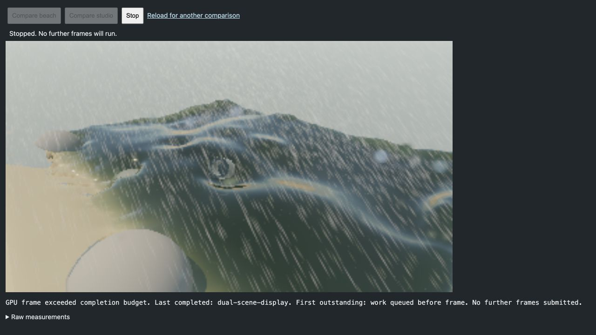
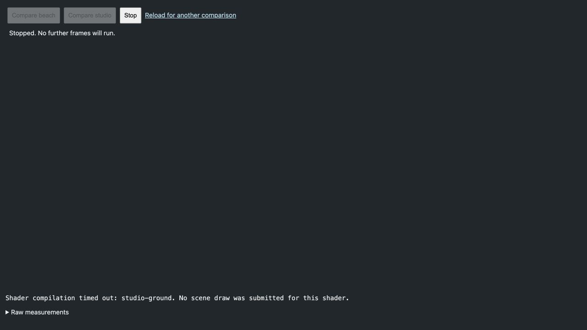

# CPU spatial-query investigation — November 19, 2026

**Decision: retain the candidates as isolated experiments. Neither is enabled in the beach, studio, or native host.** Fixed-step numerical checks pass, but the complete-scene graphics comparisons did not finish. This pass establishes where CPU work goes and measures two CPU candidates; it does not establish an application FPS or simulation-speed improvement.

## What was tested

1. **Exact terrain snapshot memoization.** Reuse identical x/z height queries within the same synchronized sand revision. No coordinate rounding or interpolation change. Invalidate on revision, height-array replacement, or bed replacement. At most 8,192 entries; stop adding entries when full and clear at the next revision. Moving objects, carved parcels, and player contacts continue through their existing queries. This spans repeated field/topology queries, unlike the earlier experiment that reused one height inside a contact normal.
2. **Actual occupied bounds for neighbor cells.** Build minimum/maximum particle coordinates for each existing hash cell, then reject particle/cell pairs that provably cannot interact. Preserve traversal order, reciprocal list insertion, precise distance cutoff, maximum neighbor count and overflow decisions. Use f64 bounds and a conservative rejection tolerance. The existing compiled and JavaScript paths remain references/fallbacks. This is a CPU WebAssembly experiment, not GPU acceleration or a different solver.

Both are installed only by the new test harness. No rendering shader, resolution, particle budget, physical coefficient, saved edit, library asset or historical test implementation changed. No new GPU pass was introduced. The studio is an unchanged A/A control, not a beneficiary of a beach-only optimization.

## CPU decomposition

Bounded Node sampling profile on this Mac: 3,024 water markers, 48 terrain edits, wind, rain and two added rigid objects; eight warmup steps and 48 sampled steps. Fine-particle graphics and GPU uploads are omitted. Instrumentation affects these timings, so use them for attribution, not as an FPS baseline. [Raw decomposition](decomposition.json).

| Work | Mean milliseconds per physics step |
| --- | ---: |
| Whole CPU step, instrumented | 49.806 |
| Field preparation | 9.946 |
| Surface stage | 6.371 |
| Neighbor construction, total | 2.908 |
| Neighbor pair arithmetic | 2.674 |
| Neighbor hash/grid construction | 0.197 |
| Contact geometry packing | 0.087 |
| Boundary arithmetic | 2.111 |
| Active surface pair arithmetic | 1.848 |
| Final contact arithmetic | 0.433 |
| Particle transport | 2.883 |

The subordinate rows overlap their parent stages; do not sum the table. Packing and hash construction are already cheap. Repeated height queries appeared prominently in the sampling profile. In the memoized diagnostic, 146,560 queries hit and 18,088 missed; its final cache had 323 entries across 56 resets. [Height diagnostic](height-cache-decomposition.json), [combined diagnostic](combined-decomposition.json). Those independent profiles are not controlled A/B timing evidence.

## Controlled CPU comparisons

Two ABBA cycles per candidate, fresh identical fixtures, eight warmup steps per block, 40 measured fixed steps per block. Each candidate has 160 reference and 160 optimized samples. No graphics, builds, other benchmarks, or test suites ran concurrently with this measurement. Timings include the complete CPU physics step but exclude rendering, GPU fine-particle work, presentation and application scheduling. **These are not FPS or realtime-speed results.** [Raw measurements](cpu-abba.json).

| Candidate | Reference → candidate CPU step | Change | Relevant stage |
| --- | --- | ---: | --- |
| Snapshot heights | 68.976 → 65.078 ms | −5.65% | Preparation 14.466 → 12.981 ms |
| Occupied neighbor bounds | 64.811 → 65.757 ms | +1.46% (slower overall) | Neighbors 4.083 → 3.796 ms |
| Both | 68.315 → 66.217 ms | −3.07% | Preparation 14.735 → 13.655; neighbors 4.213 → 3.890 ms |

System/JIT variability remains visible: the first height-reference block averaged 77.75 ms and later blocks were mostly around 64–68 ms. The second height ABBA cycle alone improves about 4.0%. The combined candidate is less convincing: its first cycle is nearly flat and a slower reference block contributes to the aggregate. Keep every block in the raw evidence; do not extrapolate the headline CPU percentages to complete-scene performance. The occupied-bounds optimization is not a useful default on this evidence.

## Complete-scene attempts and safety stops

The new `/tests/cpu-spatial-performance.html` uses a 60 FPS cap, elapsed-wall-time physics accrual, one outstanding completed frame, two-second frame limit and three-minute comparison limit. No graphics work starts before a button click. Same 960 × 540 output and fixed 320 × 200 beach rendering as the previous pass; all existing beach optical/fine-particle/sea-foam paths remain active. Studio uses 24 placements / 32 physical parts, CPU Rapier and one exact cursor query per frame, as the earlier workload did.

- **Beach:** two blocks completed, then block 3 stopped with the existing GPU completion timeout. Last confirmed pass was `dual-scene-display`; the first outstanding checkpoint was `work queued before frame`. This only places the stall before the next frame's tracked render calls; it does not identify a faulty shader or prove a device loss. The completed blocks measured 4.018 FPS / .511× and 5.281 FPS / .671×, but this incomplete ABBA comparison is **excluded**, not reported as a gain. No beach retry was attempted. [Raw stopped run](beach-stopped.json).
- **Studio control:** stopped during compilation of the unchanged `studio-ground` program, before any measured block or scene draw. This produced no FPS or simulation-speed result. [Raw stopped run](studio-stopped.json).
- After those stops, no further graphics tests were submitted. No watchdog was increased and no restart/access request was made. The result schema at the time did not include `contextLost` on failures, so actual context/device loss was **not established**. Future failures now include it when a scene was constructed; `null` means unavailable. The raw original files remain unmodified.

The beach did render during its completed blocks, but appearance parity of this new candidate was not independently established by a completed frozen-image test. The renderer itself is unchanged and the fixed-step CPU state matches exactly; that is useful evidence, not a substitute for finished visual checks. No successful dual-scene performance result is claimed.

## Validation and reproduction

- **69 focused tests pass**, covering the new exact state/neighbor/cache/fallback checks, existing neighbor and field batching/stability checks, and studio sculpt/picking/material/rigid/joint behavior.
- Complete beach state is equal through 32 steps with independent toggles, carved edits, rain, a moving cup/player, wind brush and reset. Ordered neighbor arrays and overflow agree for empty/small/dense/3,024/12,000-particle cases and near-cutoff coordinates. Cache tests cover arbitrary nearby coordinates, repeated revisions, bed and array replacement, and bounded storage. An absent or invalid candidate module retains the reference neighbor path.
- Browser and native builds pass. Neither includes a new live installation of the candidates. Native studio hosting remains unimplemented.
- No library or authored terrain files were changed. Tests use disposable in-memory fixtures.

CPU comparison: `node tools/bench-spatial-cpu.mjs output.json`. Decomposition: `node tools/profile-spatial-cpu.mjs output.json`, optionally `--cache` and/or `--tight`. Numerical gate: `node --test tests/spatial-cpu.test.js` plus the existing field and studio suites. Rebuild the isolated neighbor kernel using `node src/rtx-sand-lab/fields/spatial-cpu/build.mjs` (pinned AssemblyScript 0.28.9; `BARDO_ASC` can point to the installed compiler).

For a later healthy graphics session, `/tests/cpu-spatial-performance.html?trial=heights` isolates the more promising cache; `trial=neighbors` isolates the rejected neighbor experiment and `trial=combined` tests both. Do not promote either based on the stopped runs here. The full-scene gate and the studio's independent dirty-brick/incremental-bake lead are recorded in `DEVELOPMENT_BACKLOG.md`.
