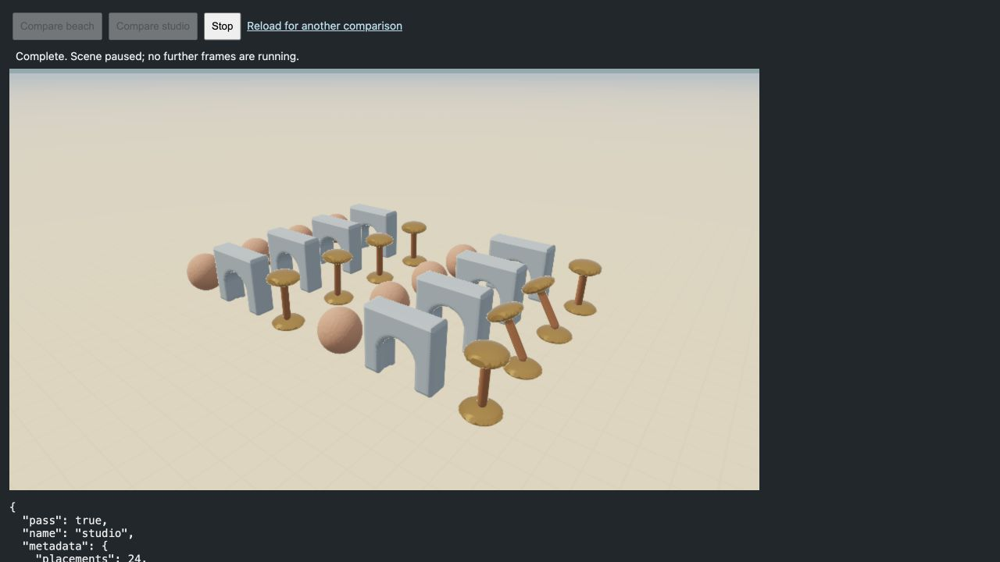

# Beach and asset studio CPU pass — November 19, 2026

The local server is running on port 5173. The live studio now uses exact, allocation-light CPU sculpt sampling/surface extraction and conservative cursor-ray rejection of whole parts. **Faster exact CPU sculpting / picking**, under Diagnostics / local files, restores the reference paths when unchecked. GPU sculpt sampling remains available and validated by the existing oracle; physics remains CPU Rapier. No simulation resolution, Gaussian coverage, SH response, collision proxy, joint, material, or stored library definition changed.

The beach contact-height reuse and studio early Gaussian rejection trials remain **experimental**. Neither established a reliable complete-scene gain. Their original live defaults remain unchanged.

## Complete-frame measurements

These are real browser rendering + physics measurements on this Mac in the Codex local preview, not kernel throughput estimates. One outstanding frame, completion fences, a two-second frame budget, a three-minute comparison budget and the 60 FPS presentation cap remain in force. The harness earns physics time from elapsed wall time and does not force extra steps. It runs two ABBA cycles, resetting the same in-memory fixture for each block, with eight warmup frames per block. No other benchmarks/builds ran concurrently.

| Workload / trial | Reference FPS → trial FPS | Simulation / wall speed | Decision |
| --- | --- | --- | --- |
| Beach, first contact trial | 6.503 → 6.685 (+2.80%) | .823 → .836 | Inconclusive |
| Beach, repeat contact trial | 6.575 → 6.535 (−0.61%) | .829 → .827 | Keep experimental |
| Studio, 32 parts + cursor queries, CPU picking only | 28.484 → 29.978 (+5.25%) | .993 → .992 | Enable exact CPU shortcuts |
| Studio, 32 parts, rendering-only rejection trial | 29.653 → 29.808 (+0.52%) | .993 → .992 | Keep experimental |

**Beach:** 3,024 water markers, 48 terrain edits, wind 18, rain 100, organic load .3, two extra rigid objects, existing fine particles/sea foam/optics; 960 × 540 output and fixed 320 × 200 scene rendering. Each block measures 32 frames, 512 measured frames across both runs. Surface/contact time fell 6.90 → 6.39 ms/step in the first run, but only 6.84 → 6.67 ms in the repeat. The smaller contact cost does not justify claiming an application speedup. Scene resets, rain and earned simulation time are controlled identically by configuration, but trajectories do not stay frame-for-frame identical under different measured wall times; repeated ABBA and the separate fixed-step state oracle address different questions. [First raw run](beach-first.json), [repeat](beach-repeat.json).

**Studio:** 24 placements / 32 physical parts, the current rigid preview limit, at fixed 960 × 540. CPU Rapier uses its unchanged 120 Hz steps and 12-step / .1 s catch-up bound. Each block measures 120 frames. The cursor stress test performs one picking query per frame while bodies run, including both hits and misses; ordinary physics-only playback does not do that every frame. This is an interaction-workload gain, **not a general 5% improvement to all studio views**. Physics already maintains about 0.99× realtime, so no physics speedup is claimed. Query time fell 2.108 → .235 ms (8.96×); start-to-start p95 frame interval fell 47.0 → 36.4 ms. [CPU interaction frames](studio-cpu-frames.json), [render-only trial](studio-physics.json).

The first combined studio run is [retained but excluded](studio-readback-rejected.json): scene playback finished, but the test tried to read a default framebuffer after the browser had discarded it. The resulting “Empty rendering” was a harness readback error, not an observed graphics failure. The corrected benchmark explicitly preserves its drawing buffer; ordinary studio rendering does not. Later comparisons and image checks pass. The rendering-only raw run predates the final `variant=render` selector; its optimized mode enabled the early-rejection trial with cursor queries disabled.

## Editing latency

Warmed CPU-only ABBA timings include sampling and surface extraction, but exclude worker messaging, uploads and drawing. They are **not FPS or simulation-speed gains**.

| Sculpt | Grid samples | Complete CPU bake | Surface extraction only |
| --- | --- | --- | --- |
| Starter | 30,752 | 23.62 → 6.69 ms (3.53× faster) | 11.04 → 1.63 ms |
| 25-stamp edited sculpt | 88,200 | 583.60 → 191.74 ms (3.04× faster) | 29.59 → 3.98 ms |

The extraction improvement also applies after the existing GPU sampling path. The CPU fallback avoids temporary coordinate/primitive arrays in the inner loop; extraction reuses corner storage and picks the nearest material without allocating and sorting eight tuples per cell. It preserves operation order, tie order, surface sample count, normals and truncation. These are still full-grid rebuilds; sparse bricks/incremental edits remain future work. [Raw CPU timings](studio-cpu.json).

## Correctness and safety

- 59 focused numerical/regression tests pass. Contact output and complete beach state agree exactly through 32 steps, edits, rain, brush forces, moving cups/player contacts, toggles and reset. The isolated contact source has a drift guard against the reference geometry.
- CPU sculpt grids and complete extracted surfaces agree exactly across seeded and mixed add/subtract/paint fixtures, material ties and truncation. Worker tests exercise reference/fast CPU bakes and extraction from already sampled buffers.
- 500 numerical picking rays agree exactly through rotations, nonuniform scale, misses and inside rays; 120 additional picking comparisons pass in the actual browser scene.
- Three frozen real-GPU studio views have zero byte difference with early rejection on/off. The promoted CPU shortcuts do not modify the renderer. The early-rejection code is isolated under `src/asset-studio/research/` and not installed in the studio.
- The ordinary studio loaded the existing local library, rendered its three placements, and rebaked the selected arch with the reference checkbox both off and on. Surface count stayed at 3,620 for that arch and 7,432 for the view. The existing WebGPU oracle passed (3,121 points, maximum error 2.38e-7, exact material IDs). No authoring or save action was performed. [Live preview](studio-live.png).
- Browser and native builds pass. Native still hosts the beach only; this work does **not** add native studio parity.
- No graphics context/device loss was observed in the completed bounded runs. This is not a claim about arbitrary long sessions or Windows/RTX performance. No saved scene/library data was changed by the benchmarks.

## Reproduction

Start `npm run dev`, then open `/tests/scene-performance.html`. Nothing draws before an explicit button click. Use **Compare beach** or **Compare studio**. The page stops after one comparison; reload before the next, which releases the old document/context instead of accumulating scenes. The normal studio comparison includes one cursor query per frame. `?hover=0&variant=render` isolates the rejected rendering trial. `?cycles=1` shortens a diagnostic run; recorded results use two cycles.

`node tools/profile-studio-cpu.mjs` reruns the independent bake-latency benchmark. Numerical gates are in `tests/contact-height-reuse.test.js` and `tests/studio-cpu-performance.test.js`, alongside the existing field/studio suites.

## Next leads

Keep testing both scenes. For the beach, split the remaining geometry packing, terrain/CSG query and neighbor pair costs before another micro-optimization; this height reuse alone is too small to move the whole frame reliably. For the studio, incremental dirty surface bricks and a spatial index *within* large parts are stronger follow-ups than another invisible-sample rendering pass. Keep picking exact, collision sampling camera-independent and the CPU reference available. Do not enlarge particle/preview budgets based on these bounded results.
