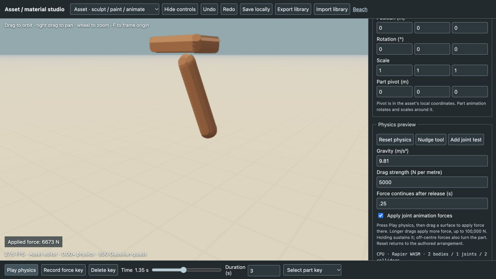

# Studio forces and joints — November 16, 2026

Isolated `/?scene=asset-studio` follow-up. No beach renderer/physics or historical snapshot behavior changed. Authoring saves retain rest transforms, legacy pose guides, new joint settings and force keys; simulation state is transient.

## Checks

- 36 focused numerical/storage/routing tests pass. New cases cover migration, invalid/cyclic joints, continuous liquidity retention, signed looping force interpolation, carved collision openings, force × duration / mass, off-centre torque, ground/object collisions, all four joint types with rotated frames, stiffness and slack, animation disruption by external force, equal/opposite load conservation, liquid exclusions, fixed-step accounting and a ten-second repeated-nudge soak.
- An initial tiny-force momentum test exposed Rapier's default low-speed sleep cutoff. Sleeping is disabled in this bounded force-testing world; the independent impulse integration test then passes, including a duration not divisible by the timestep. Do not silently restore default sleep thresholds without a low-force regression gate.
- Web and existing native builds pass. The native host still runs the beach, not this browser studio.
- In-app browser: added the articulated test asset; ran hinge and ball-joint animation; dragged the arm with recorded 8,505 N and 6,673 N cursor forces; observed displacement and continued rotation rather than target-pose snapping. Changed a saved torque key from −160 to −220 N·m at 1.5 s and independently verified the disk JSON. Reset restored authored transforms. Final preview is paused.
- Whole starter world: four bodies, 157 collider pieces, no joints; ran over 35 seconds, gravity/contact settling visible. Reported collision approximation spacing 0.137 m. Latest construction used CPU workers, keeping CSG preparation off the UI thread.
- Informal HUD observations: joint preview approximately 26–45 FPS at ~0.99–1.00× physics; world about 23 FPS / 1.00×. These are not controlled before/after performance benchmarks. Two-body steps displayed 0–0.2 ms, settled world ~0.3 ms. Display is capped at 60 FPS. No physics speedup is claimed.
- Final browser console inspection returned no warnings/errors. No observed shader/context/device failure. This is bounded validation on this Mac, not proof against every possible imported sculpture or future long session.

## Scope and limits

Contacts and joints run on CPU Rapier 0.21 WASM, at 120 Hz, ≤12 earned steps/frame. GPU sculpt sampling and CPU fallback/reference remain unchanged. No new simulation GPU passes. Collision preparation uses serial CPU worker jobs with six-second timeouts; direct CPU reference remains available for numerical tests.

Up to 32 parts, 128 collider boxes/part, 10,000 CSG sample cells/part, 64 pending force pulses. Simple primitives use exact shapes; nonuniform round primitives use convex approximations, general CSG uses merged occupied boxes. Small sculpt features can have approximate contacts. Nonuniform placement transforms that shear rotated parts are rejected. Physics is independent of camera and render spacing.

Forces and torques are interpolated open-loop loads in the parent frame, with equal/opposite reactions. No animation position motors or keyed-pose correction. Passive joint elasticity is explicitly separate and can restore the authored rest orientation. Older pose tracks remain saved as guides, not secretly converted to physical force tracks. The UI provides a new editable force test for immediate experimentation.

Freely flowing parts are visual-only and do not create rigid bodies/joints. Material retention scales with liquidity and structural support. A zero-retention joint definition may be retained dormant in an existing asset so changing the material back does not erase authoring data. The preview ground is always a solid support plane, even with a water appearance. Fluid flow, granular flow, soft deformation, fracture and thermal behavior remain unimplemented in the studio.

