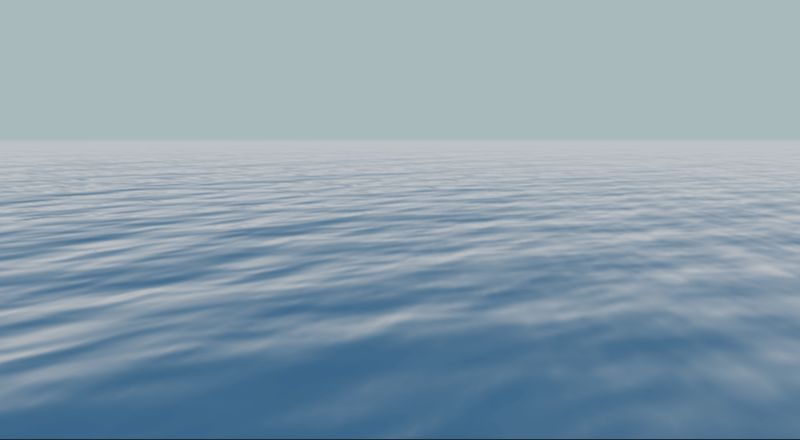

# Studio ocean, reflection and distance checks

[Run the regression](../../studio-ocean-distance.html) · [Inspect the water and falling materials](../../studio-materials.html?ground=water)

The wind sea samples three independent, differently oriented wave spectra in world metres. Each spectrum still wraps internally. The rendered surface, rigid buoyancy, sinking parcels and crest emitters share their sum. The high-frequency field updates at 20 Hz, the intermediate field at 12 Hz and the swell at 6 Hz, with interpolation between samples. Fourier evolution, contacts and particle advection run on the CPU. The GPU reconstructs the moving surface and filters its height and slope textures as they become smaller than a triangle or pixel. Local breakers and spray occupy actual world positions. Distant water is a prescribed surface, with gradually increasing atmospheric haze.

The mirror discards submerged loose matter against the wave surface. The transmission pass includes live sand geometry in its search bounds. The water material's **Volume scattering (1/m)** is a peak-channel single-scattering coefficient. Absorption and scattering both attenuate transmitted light, and only scattering contributes in-scattered environment light. A zero coefficient removes that contribution. Older materials acquire the strength inferred from their previous tint and opacity.

## Checks in the local preview

The 800 × 440 regression runs the studio renderer, drops a sand block with the real physics solver, reads back the mirror and transmitted image, and then samples an offshore camera view.

- The sand occupied 1,208 mirror pixels during its fall above the water. At full immersion the mirror contained zero sand pixels, and 5,308 pixels still showed the sand through the water. No sand pixels appeared in the sky or on water more than 25 m from the camera.
- Changing only the water scattering coefficient from 0 to 0.65/m changed 307,239 pixels.
- In 18 m/s wind, 141,917 of 154,400 sampled pixels changed in the 50–300 m range, 14,787 of 20,800 in the 300–1,000 m range, and 646 of 6,400 in the 1,000–3,500 m range, compared with calm water. The test counts differences of at least three byte levels in one colour channel.
- At 2,400 m camera height, the rendered depth silhouette agreed with the projected geometric horizon to within one pixel. On 1,152 world positions across positive and negative coordinates, the maximum difference between CPU wave heights and reconstructed GPU heights was 2.5 mm.
- The separate [optics check](../../studio-water-optics.html) passed reflection, transmission, refraction, attenuation and the connected lifted handful. The graphics context stayed healthy. All 76 focused numerical tests passed, as did the web build.

## Populated studio playback

The existing [dense comparison](../../studio-surface-cost.html?dense=1) ran the full studio at 640 × 360 with 24 floating bodies in 8 m/s wind. Each block counts 72 GPU-completed frames after six warm-ups.

| Surface rendering | FPS | Simulation / wall time | Mean completed frame |
| --- | ---: | ---: | ---: |
| Gaussian | 8.89 | 0.817× | 107.46 ms |
| Automatic | 18.03 | 0.977× | 51.06 ms |
| Automatic | 19.67 | 0.988× | 47.42 ms |
| Gaussian | 9.52 | 0.884× | 99.03 ms |

The earlier automatic run recorded 19.26–20.57 FPS and 0.938–0.950× simulation speed. Measured frame rate was slightly lower with the three-band ocean, while simulation kept up more closely in this session. These are separate runs in the local preview. Device-specific performance, multiple scattering and a fully simulated offshore breaking field remain unverified or outside this model.
