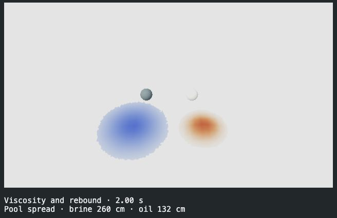

# Asset Studio playback, liquid spread and ice

## What the viewer can check

Open [Viscosity and rebound](http://localhost:5173/?scene=asset-studio&test=runoff). The two samples each contain 76.7 L and fall from the same height onto a level porcelain floor. The blue brine and amber oil use different optical tracers on this bench. Their spread readouts measure the diameter of a uniform disk with the same volume-weighted second moment as the deposited material. This avoids letting a single stray droplet dominate the comparison. At two simulated seconds they measured 2.60 m and 1.32 m. At six seconds they measured 3.01 m and 1.88 m.

Open [Melting and absorption](http://localhost:5173/?scene=asset-studio&test=thaw) for the ice lens, wax seal and wicking pad. The display follows the interior temperature and liquid fraction during a four-second heat input. Ice starts at −10 °C. Fusion consumes 334 kJ/kg at 0 °C before the fully melted connected region releases water. Fast freezing traps more scattering inclusions per newly frozen fraction. Melting removes them in proportion to how much ice remains. The calibrated comparison freezes equivalent samples over two seconds and three minutes. Refrozen puddles lose mobility, but a load-bearing sheet of ice remains future work.

The [optics and playback check](../../studio-material-playback.html) can stop at two simulated seconds, time a bounded run, or compare the same ice lens hidden, clear and rapidly refrozen. At 640 × 360 the clear lens changed 1,555 pixels from the background, and freezing it rapidly changed 2,799 pixels from the clear view. The [ground finish check](../../studio-fracture-water-check.html) changed 36,086 stone pixels for nine neighboring wet samples and zero ocean pixels for 58 wet samples. Moisture and charring shade the actual floor and carved surface, including their depth and texture.

## Timing method

The comparison uses the local Mac preview at 640 × 360, one graphics context active at a time. Both engines load the original fixture definitions from revision `569ea67`, including its camera and ground material. This keeps the new porcelain plate, optical tracers, and timed heater out of the before/after timing. Each run takes 120 fixed warm-up steps and 12 presentation frames, then measures 48 frames including CPU physics, scene rendering and GPU completion. The simulation advances with wall time and the ordinary 0.1 s catch-up limit. The order is old, new, new, old. Aggregate FPS is total frames divided by wall time and the simulation ratio is simulated seconds divided by that same wall time. The reference and current samples overlap on some scenes. Treat these as short local measurements.

| Original setup | Previous FPS | Current FPS | Previous simulation speed | Current simulation speed | Previous / current CPU physics per frame |
| --- | ---: | ---: | ---: | ---: | ---: |
| Viscosity and rebound | 16.82 | 20.39 | 0.792× | 0.881× | 2.02 / 3.56 ms |
| Melting and absorption | 22.38 | 27.37 | 0.928× | 0.903× | 14.13 / 6.49 ms |
| Structural load | 29.73 | 28.27 | 0.975× | 0.957× | 4.49 / 4.60 ms |

Flat rigid ground now draws two triangles in place of 25,088. Deformed sand and cut faces keep their geometry. The renderer avoids duplicate playback surfaces and reuses deposit connectivity until the wet footprint changes. Small liquid samples use fewer rigid contacts while retaining their total volume and mass. Structural load showed no consistent speedup. The less viscous liquid spreads over more cells and costs more CPU time in the runoff comparison. [Individual measurements](paired.json)

The independent beach guard completed on the same Mac with 3,024 markers and 48 terrain edits. Its built-in reference ran at 4.06 FPS / 0.517× and its optimized mode at 4.83 FPS / 0.613×. Both modes use existing beach code. None of the completed graphics checks lost the context.

### Updated scene setups

A separate 48-frame check with the revised colors, framing, sample sizes and heater measured 24.69 FPS / 0.990× realtime for runoff and 12.68 FPS / 0.777× for gradual heating. The old melting setup fused the ice immediately. The revised setup exercises the solid lens and the brine-soaked pad together before release. In a six-second CPU trace the first two simulated seconds took 1.14 seconds of wall time, the next two took 0.80, and the last two took 0.55. Rigid contacts remained the largest individually timed subsystem.

A repeat of the revised heating check stopped at the two-second graphics guard before its first draw. It has no timing sample. The earlier completed run, the clarity comparison, and the paired runs above all rendered successfully. Cold-start timing and performance while the lens remains intact deserve a longer follow-up.
