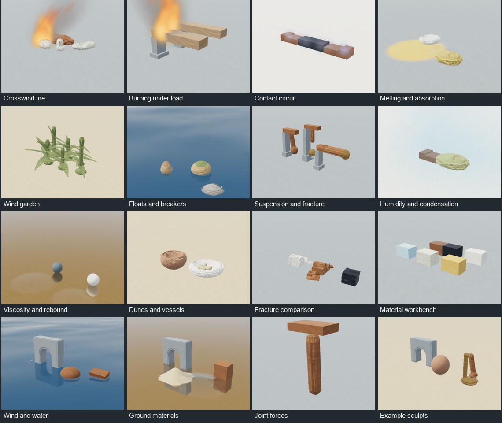

# Asset Studio scene review

Open the studio test menu to repeat these experiments. Play advances the authored setup and Reset physics restores it. The examples are separate from My library. The images below are captures from the local preview during this review.

| Studio test | What to try and what to look for |
| --- | --- |
| My library | Start with a saved placement, play, pause and select a part. The library-upgrade regression checks that adding examples preserves user edits and deletions. |
| Crosswind fire | Ignite the tinder, turn the wind and wet the hot face. The smoke drifts, the damp control stays unlit and a strong application of water extinguishes the touched face. |
| Burning under load | Watch the heated and cold cantilevers together. The burning one sheds pieces as it loses strength. The cold one continues to carry its own weight. |
| Contact circuit | Probe the graphite, move it clear of the copper shoes, then put it back. Current stops across the open gap and returns on contact. The porcelain floor stays visually neutral in the charge view. |
| Melting and absorption | Follow the ice and wax into loose liquid and the brine onto the porous pad. The melt and moisture views distinguish melting from surface wetting. |
| Wind garden | Change the wind heading and compare the six planted tufts. The attached ribbons move on their individual mounts and family members retain their different shapes. |
| Floats and breakers | Release the three floats, increase the wind, then make a local splash. The ordinary wave load carries the assembled floats without immediately tearing them apart. |
| Suspension and fracture | Let the timber support its tip weight, then push down near the end. A nudge to the chime loads its joints. A sufficiently strong nudge on the timber cracks the span. |
| Humidity and condensation | Probe the chilled copper near the vapour source. Condensate accumulates on the surface. The moisture view leaves dry surfaces recognizable. |
| Viscosity and rebound | Compare the two landing pools and the first bounce of each ball. Brine spreads faster than oil. Lift some oil and return it, or splash it across the bronze. |
| Dunes and vessels | Let the sand fall into the bowl and tip the rim. The sand stays loose inside and spills onto the deformable ground. |
| Fracture comparison | Drop the three equal-mass samples from the same height. White stock chips, brown stock splinters and dark stock separates into layers. Shape, bulk strength, friction and overload time are matched for the comparison. |
| Material workbench | Heat ice, wet felt, or nudge a sample. Hand-sized conductors can be physically separated and inspected. |
| Wind and water | Splash beside a float, lift the surface and throw water against the arch. The scene opens with the impulse tool selected. |
| Ground materials | Drop the same wood, water and sand onto different floors. Lift from the ground and compare the solid chunk with what happens on loose sand. |
| Joint forces | Drag against the powered arm, then disable the motor. Its hinge carries the weight and the player can interrupt its swing. |
| Example sculpts | Play the force animation and nudge the clay. The hanging stem has a supporting bracket and enough clearance to swing. |

## Numerical checks

The [review regressions](../../studio-scene-review.test.js) exercise the same CPU physics used in playback. The comparison tests check volume and cell ownership as grain changes, a brief overload against short and long damage times, and shard speeds after a drop. They also exercise moving and replacing the bridge, tipping the bowl, dousing burning tinder, lifting a warm pool and returning its volume, and the viscosity difference after equal settling time. The [showcase regressions](../../studio-showcase.test.js) cover the original setups, including the unheated beam and damp-fuel controls.

The drop test exposed a solver error that could throw a splinter hundreds of metres per second. Creating fragments at their actual separation pose and replacing the very wide box used for flat ground with a true plane brought the peak linear speed to 3.1–3.4 m/s in six orientations of the 0.9 m drop. The regression checks the complete drop and bounds the maximum speed independently of how many pieces separate.

Grain and damage time are editable approximations. The fracture solver resolves a limited number of regions per part. Fibre and layer directions currently follow the part's local axes. A cooled pool can resist flow, but turning it back into a load-bearing sculpt remains open.
